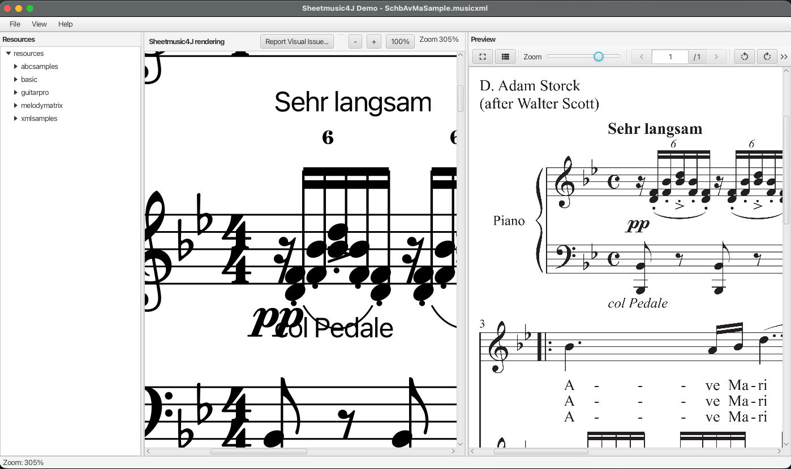

# Contributing to Sheetmusic4J

Thanks for helping improve Sheetmusic4J! The most valuable contributions right now are **reports of rendering
differences**: places where the score drawn by Sheetmusic4J doesn't match how the music should look. The demo app has
a built-in tool to capture these.

## Using the demo app

Build the project once, then launch `SheetDemoApp` (requires Java 21+ and Maven 3.9+):

```bash
mvn clean install -DskipTests
mvn -pl fxdemo javafx:run
```

You can also pass a score file to open right away, or run `com.sheetmusic4j.fxdemo.SheetDemoLauncher` from your IDE (use
the launcher, not `SheetDemoApp` itself, to avoid JavaFX runtime errors on the classpath).

The window has these parts:

| Area                       | What it does                                                                                                                                                                        |
|----------------------------|-------------------------------------------------------------------------------------------------------------------------------------------------------------------------------------|
| **Resource tree** (left)   | Browses `fxdemo/src/test/resources` by default, which has many sample scores. Click a file to open it. Use **File > Change Resources Folder...** to browse your own folder instead. |
| **Sheetmusic4J rendering** | The score as rendered by Sheetmusic4J. The toolbar has zoom buttons (`-`, `+`, `100%`) and the **Report Visual Issue...** button.                                                   |
| **Preview**                | Shown automatically when a PDF (or PNG image) with the same base name sits next to the score, e.g. `MySong.musicxml` + `MySong.pdf`. This is the reference to compare against.      |
| **Debug info**             | **View > Show debug info** shows the parsed model and layout details for the loaded score.                                                                                          |
| **Diff**                   | **View > Show Diff tab** compares the rendering with the reference PDF/image, measure by measure.                                                                                   |

If you find a difference, zoom in on both the JavaFX and image view, click the "Report Visual Issue" button and describe
the difference. In the project `/reports` directory a new directory is created with your remark, and two screenshots.
Upload this together with the score file into a new GitHub issue.



Other useful menu items:

- **File > Open...** (`Ctrl/Cmd+O`) opens MusicXML (`.musicxml`, `.xml`, `.mxl`), MIDI (`.mid`, `.midi`), ABC (`.abc`),
  LilyPond (`.ly`), Guitar Pro (`.gp`) and engraved PDF (`.pdf`) files. A PDF opened this way is shown in the preview
  pane too, so you can compare the engraved score with the original.
- **File > Reload** (`Ctrl/Cmd+R`) re-reads the current file, handy while you edit it.
- **View > Text** toggles titles, lyrics, dynamics, chord symbols and other markings on and off, to isolate a problem.

### Strip and fly-over demos

Three more demo apps show the play-along views and the node-based view. Open a score with **File > Open...** (or pass
its path as the first argument), then press **Play** or drag the position slider. In the node view there is no playback:
click to select a note, drag it to move it (hold Shift for a sharp, Alt/Option for a flat):

```bash
mvn -pl fxdemo -Pstrip javafx:run      # StripDemoApp: one-line strip view (StripSheetView)
mvn -pl fxdemo -Pflyover javafx:run    # FlyOverDemoApp: 3D fly-over view (FlyOverSheetView)
mvn -pl fxdemo -Pnode javafx:run       # NodeDemoApp: node-based view, select and drag notes (NodeSheetView)
```

From an IDE, run `StripDemoLauncher`, `FlyOverDemoLauncher` or `NodeDemoLauncher`. These apps don't have the report button; reproduce
rendering problems in `SheetDemoApp`, or describe them in an issue with a screenshot.

## Reporting a visual issue

1. Open the score that shows the problem. If you have a PDF of how it *should* look, put it next to the score file with
   the same base name, so it appears in the preview pane and is captured too.
2. Scroll and zoom so the problem is visible in the **Sheetmusic4J rendering** pane. Only the visible part is captured.
3. Click **Report Visual Issue...** in the toolbar above the score.
4. Describe what's wrong: which part, measure and element, and what you expected instead. For example: *"Part 1,
   measure 12: the tie between the two E notes is drawn above the staff, it should curve below the noteheads."*
   [docs/NOTATION_ELEMENTS.md](docs/NOTATION_ELEMENTS.md) can help you name the elements.
5. Click **OK**. The status bar shows where the report was saved.

Each report is a folder `reports/report-<timestamp>/` in the app's working directory, containing:

| File          | Content                                                                      |
|---------------|------------------------------------------------------------------------------|
| `score.png`   | Screenshot of the Sheetmusic4J rendering                                     |
| `preview.png` | Screenshot of the reference preview (only when the preview pane was shown)   |
| `report.json` | Your description, the path of the score file, the zoom level and a timestamp |

### Sharing the report

[Open an issue](https://github.com/sheetmusic4j/sheetmusic4j/issues/new) on GitHub and:

- paste the description from `report.json`,
- drag `score.png` and `preview.png` into the issue,
- attach the score file itself (zip it if GitHub refuses the extension), and its reference PDF if you have one,
  unless they're among the samples in `fxdemo/src/test/resources`, in which case naming the file is enough.

Only share scores you're allowed to share.

## Code contributions

- Build and run all tests with `mvn clean install` before opening a pull request.
- See [CLAUDE.md](CLAUDE.md) for the module layering and conventions: `core`, `engraving` and `render` must stay free
  of JavaFX, and all drawing goes through `ScorePainter` and the `RenderSurface` abstraction.
- Engraving changes show up in `LayoutSnapshotTest`. If the change is intentional, regenerate the snapshots with
  `-Dsheetmusic4j.snapshots.update=true` and mention it in the pull request.
